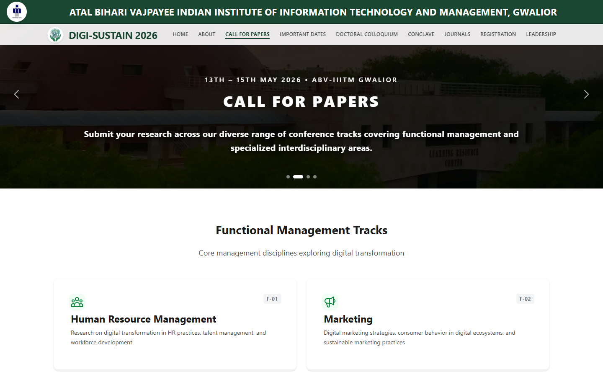
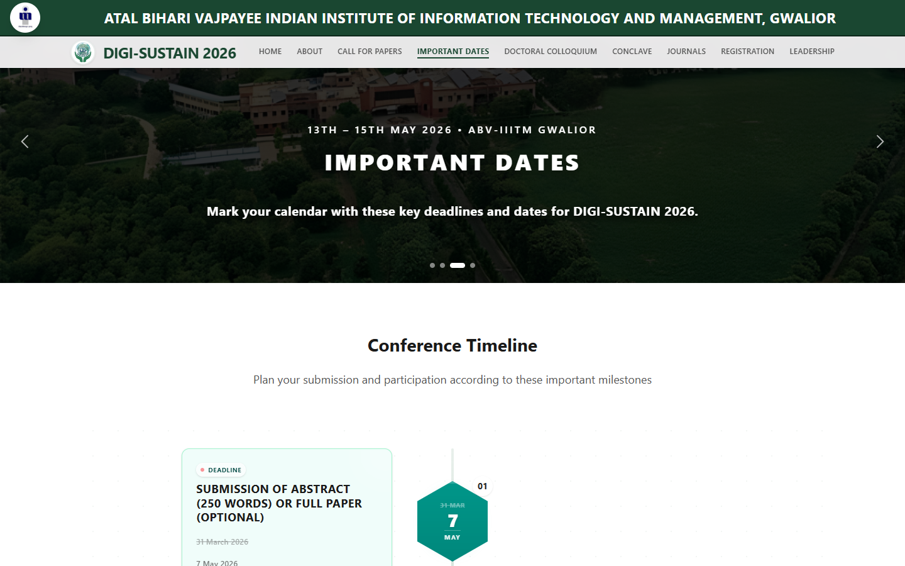
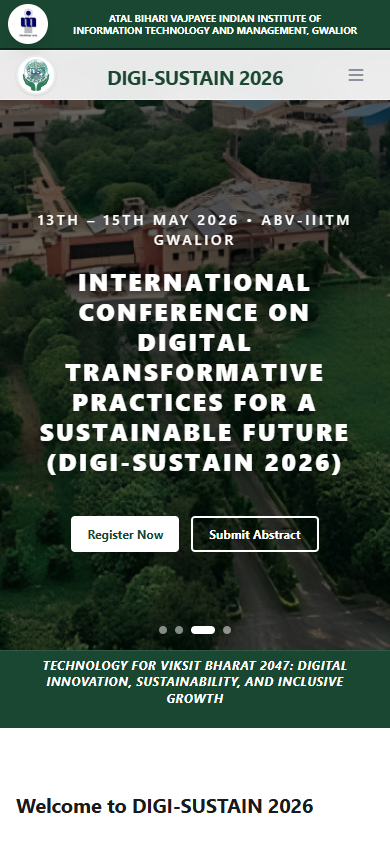

# DIGI-SUSTAIN 2026: Conference Website

Official website for **DIGI-SUSTAIN 2026**, the International Conference on Digital Transformative
Practices for a Sustainable Future, hosted by the Department of Management Studies at
ABV-IIITM Gwalior on 13–15 May 2026.

**Live site:** [digi-sustain-2026.vercel.app](https://digi-sustain-2026.vercel.app)


## What it does

The site is where researchers and delegates learn about the conference, submit abstracts and register.

| Page | What it covers |
|---|---|
| Home | Hero carousel, conference theme, call-to-action for registration and abstract submission |
| About | The conference theme and the host institute and department |
| Call for Papers | Functional management tracks and specialised interdisciplinary tracks |
| Important Dates | Submission and registration timeline, with revised deadlines shown next to the originals |
| Doctoral Colloquium | Highlights of the doctoral research track |
| Conclave | Directors' conclave and speaker details |
| Journals | Partner journals for publishing selected papers |
| Registration | Fee structure by delegate category |
| Leadership | Patron, chairs, coordinators, advisory and editorial boards |

## Screenshots

| Call for Papers | Important Dates |
|---|---|
|  |  |

<p align="center"></p>

## How it is built

- **Content kept apart from layout.** Dates, tracks, fees, journals and committee members live in
  `src/data/`. Organisers can update the conference details without touching any component.
- **One design at every desktop size.** `ScaleWrapper` scales the 1536 px design to the screen
  width on desktops. On tablets and phones it switches to a responsive layout with a collapsible menu.
- **Single-page app on Vercel.** Routing uses React Router. `vercel.json` rewrites every path to
  `index.html`, so deep links like `/important-dates` work.

```
src/
├── components/   # layout (navbar, footer), home, tracks, dates, journals, registration, committee, ui
├── constants/    # route table and navigation order
├── data/         # all conference content
└── pages/        # one component per route
```

## Run locally

Requires Node.js 20 or newer.

```bash
npm install
npm run dev      # http://localhost:5173
npm run build    # production build in dist/
```

## Team

Built by [@aayuxsh326](https://github.com/aayuxsh326), [@SK8-infi](https://github.com/SK8-infi)
and [@itsnjstyle27](https://github.com/itsnjstyle27).
